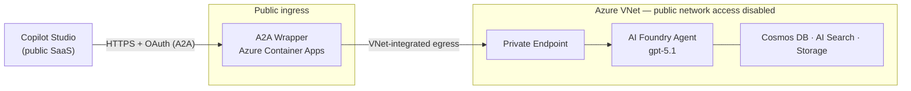

# Network-Isolated Azure AI Foundry Agent — with A2A Access for Copilot Studio

Deploy a **network-secured Azure AI Foundry Standard Agent** (private endpoints, no public
network access, VNet-injected), then expose it to external agent-to-agent (A2A) callers such
as **Microsoft Copilot Studio** through a small, secured **broker/wrapper** running on Azure
Container Apps.

The Foundry agent and all of its data stores stay fully private. The wrapper is the only
component with a public surface, and it reaches Foundry over the virtual network.

## Delivery problem and evidence

An external agent client needs a reachable discovery and invocation endpoint, while the
Foundry agent and its data stores must remain behind private endpoints. This repository
implements that boundary rather than treating an agent connection as just a model call.

| Constraint | Engineering decision |
|---|---|
| External clients cannot directly reach a private backend | A Container Apps broker exposes HTTPS ingress and uses VNet-integrated egress |
| Discovery and invocation have different access requirements | Public agent-card discovery; Entra-authenticated A2A invocation |
| The broker needs to call Foundry without a stored service key | A user-assigned managed identity with a project role |
| A reviewer needs to inspect both application and infrastructure | [Python broker](a2a-wrapper/) and [Terraform source](infra/) are included |

**Start here:** [architecture and integration findings](docs/architecture.md),
[deployment steps](#quick-start), and [authentication boundary](#security-model).

**Scope:** a reference architecture and implementation. The integration notes record the
original validation; no fresh Azure deployment, authenticated end-to-end run, or production
readiness assessment was performed for this documentation update. The broker is public-facing;
"private" describes the Foundry backend and data stores, not the entire request path.



> **Two layers, deployed together:**
> 1. **`infra/`** — Terraform for the network-isolated Foundry account, project, data stores,
>    private endpoints, private tracing, and the wrapper's Container Apps hosting.
> 2. **`a2a-wrapper/`** — the containerized A2A façade (Python / Starlette on the A2A SDK) that
>    fronts the private Foundry agent.

---

## Repository layout

```text
.
├── infra/                     # Terraform: infrastructure as code
│   ├── main.tf                # resource group + unique-suffix
│   ├── network.tf             # virtual network + subnets (agent-delegated, private-endpoint, ACA)
│   ├── storage.tf             # storage account (agent data)
│   ├── cosmos.tf              # Cosmos DB (agent thread storage)
│   ├── search.tf              # Azure AI Search (vector store)
│   ├── foundry.tf             # Foundry account + gpt-5.1 deployment + soft-delete purge
│   ├── foundry_project.tf     # project, connections, capability host
│   ├── private_dns.tf         # private DNS zones + VNet links
│   ├── private_endpoints.tf   # private endpoints for the isolated services
│   ├── monitor.tf             # Application Insights + AMPLS (private agent tracing)
│   ├── rbac.tf                # role assignments + RBAC propagation waits
│   ├── wrapper.tf             # ACR, managed identity, Container Apps env + the wrapper app
│   ├── variables.tf           # all input variables (base + wrapper)
│   ├── outputs.tf             # wrapper URLs, ACR name, project endpoint, identity client id
│   ├── data.tf / locals.tf
│   ├── providers.tf / versions.tf
│   └── terraform.tfvars.example
├── a2a-wrapper/               # the A2A façade application (containerized)
│   ├── app/
│   │   ├── main.py            # A2A app; serves the agent card + RPC endpoint
│   │   ├── config.py          # env-driven settings
│   │   ├── auth.py            # inbound Entra OAuth (JWT) validation middleware
│   │   ├── agent_executor.py  # bridges A2A tasks to the Foundry agent
│   │   └── foundry_client.py  # create-or-get + invoke the Foundry agent (managed identity)
│   ├── Dockerfile
│   └── requirements.txt
├── docs/                      # architecture notes + the integration finding
├── images/                    # architecture diagram (SVG)
├── .gitignore
└── README.md
```

---

## What gets deployed

| Category | Resources |
|---|---|
| **Foundry** | Azure AI Foundry account (`AIServices`, public access disabled), project, `gpt-5.1` deployment, capability host |
| **Data stores** | Cosmos DB (thread storage), Azure AI Search (vector store), Storage account — all private, local-auth disabled |
| **Networking** | Virtual network + 3 subnets (agent-delegated, private-endpoint, Container Apps), private DNS zones, private endpoints for every service |
| **Private tracing** | Log Analytics, Application Insights (private ingestion), Azure Monitor Private Link Scope (AMPLS) + its private endpoint |
| **A2A wrapper** | Azure Container Registry, user-assigned managed identity, Container Apps environment (VNet-injected), the wrapper Container App |
| **RBAC** | Project managed identity granted the least-privilege roles it needs on Cosmos DB, Search, and Storage; wrapper identity granted `AcrPull` and `Foundry User` |

Model deployment is `gpt-5.1` by default; change it in `foundry.tf` if your region/quota differs.

---

## Prerequisites

1. **Azure subscription** with permission to create the resources and role assignments. For a
   manual deployment the operator needs, over the target resource group:
   - *Role Based Access Control Administrator* (to create role assignments)
   - *Network Contributor* (VNet + private endpoints)
   - *Azure AI Account Owner* (Foundry account + project)
   - *Foundry User* (to create/invoke agents)
2. **Registered resource providers** (subnet delegation needs `Microsoft.App`):
   ```bash
   az provider register --namespace Microsoft.CognitiveServices
   az provider register --namespace Microsoft.Storage
   az provider register --namespace Microsoft.Search
   az provider register --namespace Microsoft.DocumentDB
   az provider register --namespace Microsoft.Network
   az provider register --namespace Microsoft.App
   az provider register --namespace Microsoft.ContainerRegistry
   az provider register --namespace Microsoft.Insights
   ```
3. **Tooling**: Azure CLI, Docker not required (images build in ACR), and **Terraform ≥ 1.10**.
   Providers used: `azurerm ~> 4.37`, `azapi ~> 2.5`, `random`, `time`.
4. **Region**: `location` must support the network-secured Standard Agent and match the region
   of your VNet and data stores. See
   [model & region support](https://learn.microsoft.com/azure/ai-foundry/agents/concepts/model-region-support).

---

## Quick start

All Terraform commands run from **`infra/`**.

### 1 — Deploy the private infrastructure

```bash
cd infra
cp terraform.tfvars.example terraform.tfvars      # then edit: set `location`, size the CIDRs
export ARM_SUBSCRIPTION_ID="<your-subscription-id>"   # Windows PowerShell: $env:ARM_SUBSCRIPTION_ID="..."
terraform init
terraform apply
```

This provisions everything except the wrapper's real image — the Container App comes up first
on a public placeholder image (`wrapper_image` default) so the environment is ready.

### 2 — Build & roll out the wrapper image

```bash
# from the repo root — build the image in ACR (name is a terraform output: a2a_acr_name)
az acr build --registry "$(terraform -chdir=infra output -raw a2a_acr_name)" \
  --image a2a-wrapper:v1 ./a2a-wrapper
```

Then point the Container App at it and (optionally) toggle auth, and re-apply:

```hcl
# infra/terraform.tfvars
wrapper_image        = "<acr-login-server>/a2a-wrapper:v1"
wrapper_auth_enabled = true
```

Configure the audience and caller permissions in **Inbound authentication** before invoking
the broker. Do not expose an unauthenticated invocation endpoint as a production setup.

```bash
cd infra && terraform apply
```

The wrapper's public URL and agent-card URL are Terraform outputs:

```bash
terraform -chdir=infra output a2a_wrapper_url
terraform -chdir=infra output a2a_agent_card_url
```

### 3 — Connect Copilot Studio (optional)

Add the wrapper as an **Agent-to-Agent** connection in Copilot Studio using the
`a2a_wrapper_url` as the **Agent endpoint URL**. The wrapper serves a Copilot Studio-compatible
agent card at `/.well-known/agent.json`, `/.well-known/agent-card.json`, and `GET /`, so
endpoint discovery validates. For authenticated access, see **Inbound authentication** below.
A full walkthrough is in [`docs/`](docs/).

---

## Configuration

Set these in `infra/terraform.tfvars` (see `terraform.tfvars.example` for the base set).

### Base infrastructure

| Variable | Default | Purpose |
|---|---|---|
| `location` | *(required)* | Azure region; must match the VNet/data-store region |
| `virtual_network_address_space` | `192.168.0.0/16` | VNet CIDR (RFC1918) |
| `agent_subnet_address_prefix` | `192.168.0.0/24` | Subnet delegated to the agent service |
| `private_endpoint_subnet_address_prefix` | `192.168.1.0/24` | Subnet for private endpoints |

### A2A wrapper

| Variable | Default | Purpose |
|---|---|---|
| `aca_subnet_address_prefix` | `192.168.2.0/23` | Subnet for the Container Apps environment (Consumption needs ≥ /23) |
| `wrapper_image` | public hello-world placeholder | Set to your ACR image after `az acr build` |
| `wrapper_auth_enabled` | `true` | Enforce inbound Entra OAuth on the A2A endpoint |
| `wrapper_entra_audience` | `""` | Expected token `aud` (the wrapper API app's client id / App ID URI) |
| `wrapper_required_scope` | `""` | Optional app role/scope the caller must present (e.g. `A2A.Invoke`) |
| `wrapper_agent_instructions` | *(helpful default)* | System instructions for the agent the wrapper provisions |
| `wrapper_foundry_role` | `Azure AI User` | Foundry role for the wrapper identity. If it fails to resolve, use `Foundry User` |

> **Heads-up:** in some tenants `Azure AI User` has been renamed — if `terraform apply` can't
> resolve it, set `wrapper_foundry_role = "Foundry User"`.

---

## Security model

- **No public network access** — the Foundry account, project, Cosmos DB, AI Search, and Storage
  are all `publicNetworkAccess = Disabled` and reached only through private endpoints with private
  DNS. Application Insights ingestion is private via AMPLS.
- **Managed identities, no secrets** — the Foundry project uses a system-assigned identity; the
  wrapper uses a user-assigned identity (`AcrPull` + `Foundry User`). No keys are stored in code.
- **Least-privilege RBAC** — the project identity gets only the data-plane roles it needs
  (Cosmos DB Operator + built-in data contributor, Search Index/Service Contributor, Storage Blob
  Data Contributor/Owner scoped by an ABAC condition to the agent's own containers).
- **Inbound authentication (wrapper)** — the wrapper validates Entra ID bearer tokens
  (signature, issuer, audience, optional scope/role) on its A2A endpoint. The agent card and
  `/health` are intentionally public so clients can discover the agent before a connection exists.

### Inbound authentication

Copilot Studio's A2A connector uses the OAuth **authorization-code** flow. To secure the wrapper:

1. Register an Entra **API app** for the wrapper (v2 access tokens); set `wrapper_entra_audience`
   to its client id and `wrapper_auth_enabled = true`.
2. Register a **caller app** (client id + secret) that Copilot Studio authenticates with, and
   grant it access to the wrapper API.
3. Configure the Copilot Studio connection's OAuth settings with the tenant's
   `authorize`/`token` endpoints, the caller's client id/secret, and the wrapper scope.

See [`docs/`](docs/) for the end-to-end walkthrough and the reasoning behind the broker pattern.

---

## Operations & troubleshooting

- **Wrapper not answering / Copilot Studio "can't find agent card"** — confirm discovery paths
  return 200: `GET {wrapper_url}/.well-known/agent-card.json` and `GET {wrapper_url}/`.
- **Container App revision stuck "Activating"** — check logs:
  `az containerapp logs show -n <app> -g <rg> --revision <rev> --type console`. A crash-loop is
  usually an image/dependency issue, not infrastructure.
- **`az acr build` prints a Unicode error on Windows but the tag appears** — that's a CLI
  log-streaming quirk; the build still succeeds. Verify with `az acr task list-runs -r <acr>`.
- **Line endings** — `.tf` files are kept **CRLF** on purpose: the Storage Blob Data Owner ABAC
  condition is a line-ending-sensitive heredoc stored that way in state. Re-normalize to CRLF
  after running `terraform fmt` to avoid a spurious role-assignment replacement.

---

## Post-deployment

Grant any developers who will create/edit agents in the project the **Foundry User** role at the
project scope.

---

## Acknowledgements

The network-isolated Foundry infrastructure is derived from Microsoft's
[network-secured Standard Agent](https://learn.microsoft.com/azure/ai-foundry/agents/how-to/virtual-networks)
sample. The A2A wrapper, Copilot Studio integration, and private-tracing additions are extensions
on top of that baseline.

## References

- [Foundry Agents — virtual networks](https://learn.microsoft.com/azure/ai-foundry/agents/how-to/virtual-networks)
- [Foundry — configure private link](https://learn.microsoft.com/azure/ai-foundry/how-to/configure-private-link)
- [Foundry RBAC](https://learn.microsoft.com/azure/ai-foundry/concepts/rbac-azure-ai-foundry)
- [A2A protocol](https://a2a-protocol.org/)
- [Azure Container Apps networking](https://learn.microsoft.com/azure/container-apps/networking)
