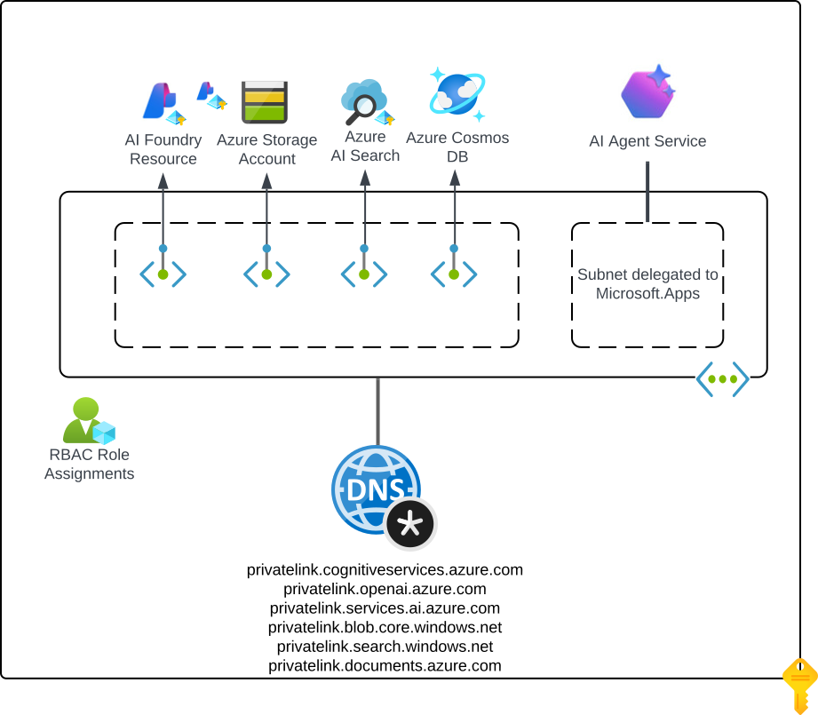

# Architecture & integration notes

## Summary

Copilot Studio can reach an Azure AI Foundry agent that is locked behind a **private endpoint** —
but **not with a direct connection**. Two mismatches block the direct path; a small **secured
broker/wrapper** in front of Foundry solves both. The result is a validated end-to-end path:

```text
Copilot Studio → wrapper (public) → VNet egress → private endpoint → gpt-5.1 → response
```

## Base infrastructure

The Terraform in [`../infra/`](../infra/) deploys a network-secured Foundry Standard Agent: the
Foundry account, project, Cosmos DB, AI Search, and Storage all have public network access
disabled and are reached only through private endpoints with private DNS. Agent tracing is
exported privately to Application Insights via an Azure Monitor Private Link Scope (AMPLS).



## Why a direct Copilot Studio → Foundry connection doesn't work

1. **Agent-card discovery isn't aligned.** Copilot Studio expects the external A2A agent card at
   `/.well-known/agent.json` (and, in current builds, probes `/.well-known/agent-card.json` and
   `GET /`), while Foundry documents versioned card endpoints such as
   `/endpoint/protocols/a2a/agentCard/v1.0` and `/v0.3`.
2. **Foundry's inbound endpoint is Entra-gated and private.** Foundry's hosted A2A endpoint
   requires Microsoft Entra authentication — including access to the agent card itself — and the
   caller must hold the required Foundry role on the project. Combined with the agent being
   isolated behind a private endpoint, a direct connection can't be established reliably.

**Recommendation:** validate direct A2A in a short PoC; use the secured broker/wrapper pattern
wherever production reliability or private-network isolation is required.

## The broker/wrapper

A containerized A2A server ([`../a2a-wrapper/`](../a2a-wrapper/)) on Azure Container Apps sits
between Copilot Studio and the private Foundry agent:

- **Public HTTPS ingress** that Copilot Studio can reach; **VNet-integrated egress** so it calls
  Foundry over the private endpoint. The Foundry account, project, Cosmos DB, AI Search, and
  Storage all stay `publicNetworkAccess = Disabled`.
- Authenticates to Foundry with a **user-assigned managed identity** (Foundry User role) and
  creates/invokes the agent on the caller's behalf.
- Serves a Copilot Studio-compatible **agent card** at `/.well-known/agent.json`,
  `/.well-known/agent-card.json`, and `GET /`, so endpoint validation succeeds.
- Validates inbound **Entra OAuth** (audience/issuer, optional app role) on the A2A endpoint;
  the card and `/health` stay public for discovery.

## Wiring Copilot Studio

Copilot Studio's A2A connector uses the OAuth **authorization-code** flow (Authorization URL +
Token URL + Refresh URL + Redirect URL), not client-credentials. To secure the connection:

1. Register a wrapper **API app** (v2 tokens); set `wrapper_entra_audience` to its client id and
   `wrapper_auth_enabled = true`.
2. Register a **caller app** (client id + secret) and grant it access to the wrapper API
   (a delegated `access_as_user` scope; add Copilot Studio's generated redirect URI to the app).
3. In the Copilot Studio connection, set the tenant `authorize`/`token` endpoints, the caller's
   client id/secret, and the wrapper scope.

To validate connectivity first, set `wrapper_auth_enabled = false`, connect with
**Authentication = None**, confirm the agent answers, then layer OAuth back on.

## Operational notes

- `az acr build` may print a Unicode error on Windows while the build still succeeds — verify
  with `az acr task list-runs -r <acr>`.
- Keep `infra/*.tf` as CRLF (see [`../infra/README.md`](../infra/README.md)); the Storage Blob
  Data Owner ABAC condition heredoc is line-ending-sensitive in state.
